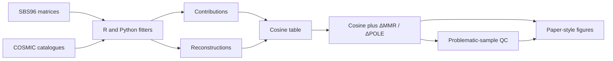

# Algorithm, reference catalogue, and NGS scope jointly shape mutational-signature readouts in colorectal cancer: an independent replication and expansion of Battuello *et al.*

**Independent replication and expansion** · Battuello *et al.*, *Briefings in Bioinformatics* (2024), [doi:10.1093/bib/bbae249](https://doi.org/10.1093/bib/bbae249)

---

## Abstract

Mutational-signature fitting is widely used to stratify colorectal cancer (CRC) by mismatch-repair (MMR) deficiency and POLE ultramutation, yet quantitative readouts depend on the fitting algorithm, COSMIC reference catalogue, and sequencing assay. Battuello *et al.* (2024) quantified these effects in preclinical and clinical CRC using dual mathematical and biological criteria. Here we independently reimplemented that framework and expanded it across additional fitting tools, newer COSMIC releases, and a quality-control discard experiment informed by Maura *et al.* (2019).

We analysed preclinical CRC cell lines (WES and TSO-500, *n* = 230; WGS, *n* = 63) and TCGA clinical WES (*n* = 152) with ten catalogue-fitting tools and COSMIC v2, v3.2, v3.4, v3.5, and v3.6, plus a CRC tissue-specific (TS) subset. Key paper benchmarks reproduced within tight tolerance: MutationalPatterns ΔMMR of 0.344 / 0.257 / 0.272 for v2 / v3.2 / TS (paper ≈ 0.34 / 0.26 / 0.27); SigProfilerAssignment (SPA) assignment rate 79.1% on preclinical WES with COSMIC v2 (paper ≈ 79%); and NGS ΔMMR ordering TSO-500 > WES > WGS (0.323 > 0.257 > 0.115) with elevated flat-signature contributions on WGS MSI. Among the paper’s original tools, SPA maximised ΔMMR (0.675); with expanded tools, sigLASSO ΔMMR (0.734) exceeded SPA. Mutation downsampling across catalogues showed that the mutation count needed for cosine ≥ 0.9 falls as catalogues grow. Discarding samples flagged for low cosine, low mutation count, or high flat load did not systematically strengthen ΔMMR or overall survival associations. Metanormal rematching and regional WGS matrices from the original paper were unavailable and are reported as limitations.

Overall, algorithm and reference choice remain dominant sources of variability in CRC signature readouts. High reconstruction cosine on WGS does not imply stronger MMR/POLE subtype contrast, and sequencing breadth does not substitute for biologically appropriate genomic scope when the goal is MMR/POLE stratification.

---

## 1. Introduction

Single-base-substitution (SBS) mutational signatures summarise the processes that shape cancer genomes and are routinely inferred by fitting observed 96-trinucleotide profiles to reference catalogues such as COSMIC. In colorectal cancer, signature contributions linked to defective MMR and to POLE exonuclease-domain mutations are clinically informative for subtype stratification. In practice, however, signature assignment is not a single standardised procedure: laboratories choose among many fitting algorithms, successive COSMIC releases, and assays ranging from targeted panels through whole-exome sequencing (WES) to whole-genome sequencing (WGS).

Battuello *et al.* systematically evaluated how these workflow choices affect CRC signature readouts using two complementary criteria: (i) a **mathematical** criterion based on cosine similarity between observed and reconstructed SBS96 profiles (samples with cosine ≥ 0.9 considered assigned); and (ii) a **biological** criterion based on separation of known subtypes—ΔMMR (median MSI − MSS MMR-signature contribution) and ΔPOLE (median POLE-MUT − POLE-WT among MSS samples). Along three axes—fitting algorithm, reference catalogue, and NGS scope—they showed that reconstruction fidelity and subtype contrast can move in opposite directions, and that coding-enriched assays can outperform genome-wide profiles for MMR/POLE stratification.

Independent reimplementation remains important for catalogue-fitting studies: software versions, catalogue builds, and preprocessing details can shift quantitative outputs even when the scientific question is unchanged. COSMIC has also continued to evolve beyond the versions emphasised in the original paper, and several additional fitting packages are now in common use. Separately, practical guides such as Maura *et al.* (2019) caution that flat signatures, sparse mutation counts, and poor reconstructions can produce unstable or biologically misleading attributions—raising the question of whether discarding such “problematic” samples improves subtype associations.

This work therefore had three aims: (i) to **replicate** the key Battuello *et al.* benchmarks on publicly available CRC SBS96 matrices within stated numerical tolerance; (ii) to **expand** the analysis across a broader tool set, newer COSMIC releases (v3.4–v3.6), a CRC tissue-specific catalogue, and a multi-catalogue mutation-burden analysis; and (iii) to test whether **discarding problematic samples** systematically improves ΔMMR, ΔPOLE, or overall survival association in the clinical cohort.

---

## 2. Methods

### 2.1 Cohorts and mutation catalogues

Four SBS96 count matrices were analysed (GRCh38 contexts), matching the cohorts used by Battuello *et al.*:

| Cohort | Assay | Samples | Role |
|--------|-------|---------|------|
| Preclinical CRC cell lines | WES | 230 | Primary algorithm / reference grid |
| Preclinical CRC cell lines | TSO-500 | 230 | NGS-scope comparison |
| Preclinical CRC cell lines | WGS | 63 | NGS-scope comparison |
| TCGA clinical CRC | WES | 152 | Clinical contrast; mutation-threshold and survival analyses |

Sample labels for MSI / MSS and POLE-MUT / POLE-WT were taken from project metadata derived from the paper’s supplementary tables. MMR, POLE, flat, and artefact signature groups were defined per COSMIC version (v2 `Signature_*` names; v3.x SBS names; SBS40a/b/c summed to SBS40 where relevant).

### 2.2 Reference catalogues

Catalogue fitting used COSMIC SBS references on GRCh38:

- **COSMIC v2**, **v3.2**, **v3.4**, **v3.5**, **v3.6**
- **TS** — CRC tissue-specific subset of COSMIC v3.2 (24 SBS), matching the GitHub `CRC_Specific` list accompanying Battuello *et al.* (the paper text cites *n* = 26; we use the published list and disclose the difference)

### 2.3 Fitting algorithms

**Paper core (five tools):** MutationalPatterns, deconstructSigs, signature.tools.lib, SigProfilerAssignment (SPA), MuSiCal.

**Expansion (five additional tools):** sigLASSO, sigfit, sigminer, SigsPack, YAPSA.

SignatureAnalyzer was disabled: the available implementation performs *de novo* NMF with post-hoc mapping rather than equivalent catalogue fitting, and is not comparable under the cosine / contribution schema used here.

R and Python fitters wrote signature contributions (`signatures × samples`) and reconstructed catalogues (`contexts × samples`) under a shared directory layout. Cosine similarity between observed and reconstructed SBS96 profiles was stored in a master long table. Samples with cosine ≥ **0.9** were labelled assigned.

A few tool × catalogue combinations produced missing cosines (notably some sigLASSO × v2 fits); these were dropped from distribution plots and flagged in quality control. On overcomplete catalogues (e.g. COSMIC v3.6), SigsPack fell back from quadratic programming to non-negative least squares when required—a solver detail, not a biological finding.

### 2.4 Dual evaluation criteria

Following Battuello *et al.*:

1. **Mathematical.** Cosine similarity; assignment rate = fraction of samples with cosine ≥ 0.9.
2. **Biological.** For each Tool × COSMIC × Dataset, sum contributions within the MMR (or POLE) signature group; compute ΔMMR = median(MMR | MSI) − median(MMR | MSS) and ΔPOLE = median(POLE | POLE-MUT) − median(POLE | POLE-WT among MSS). Group differences were tested with two-sided Wilcoxon rank-sum tests.

Figures follow the paper’s visual grammar (`theme_bw`; MSI/MSS colours `lightblue1`/`salmon2`; POLE colours `darkgoldenrod1`/`olivedrab4`; dashed line at cosine = 0.9).

### 2.5 Mutation-count downsampling

To estimate the minimum mutation count supporting cosine ≥ 0.9, SBS96 profiles were multinomial-subsampled at fractions 5–95% (five replicates), refitted with MutationalPatterns for every COSMIC key in the pipeline, and summarised as cosine-versus-mutation curves and inferred thresholds. This addresses the same scientific question as the paper’s variant-list shuffling experiment; absolute thresholds are approximate and method-dependent. Paper Fig. 6C–D metanormal rematching (PBMC-matched calling) was not reproduced (no local metanormal / PBMC data); our Fig6C–F report the multi-COSMIC expansion instead.

### 2.6 Problematic-sample discard and survival

Informed by Maura *et al.* (2019), samples were flagged as problematic if **any** of the following held for a given Tool × COSMIC × Dataset:

1. cosine similarity < 0.9;
2. mutation count below the Dataset × COSMIC threshold inferred in §2.5 (fallback 323 / 64 for preclinical / clinical if unavailable);
3. flat-signature contribution ≥ 0.25.

ΔMMR and ΔPOLE were recomputed after discarding flagged samples (filters: drop low cosine; drop low mutations; drop high flat; drop any). Overall survival (OS) for the clinical WES cohort was obtained from the GDC API for TCGA-COAD/READ (*n* = 152 patients; 36 death events). Association of MMR contribution with OS was assessed by median-split Cox models and log-rank tests before versus after filtering for selected tool × catalogue settings.

### 2.7 Analyses not reproduced

The following original-paper panels were omitted for lack of input data:

- Metanormal rematching (paper Fig. 6C–D).
- Exon / intron / extragenic regional SBS96 pies (paper Fig. 3D, right). Signature-class stacked bars by NGS type (Fig10) are used as a related proxy, emphasising flat-signature inflation on WGS MSI.

### 2.8 Analysis pipeline overview

---

## 3. Results

### 3.1 Study design

Analyses were organised along the three axes of Battuello *et al.*—algorithm, reference catalogue, and NGS scope—plus multi-COSMIC mutation-burden and problematic-sample discard expansions. The master cosine table contains **34,132** rows spanning ten enabled tools × six catalogue keys × available datasets (preclinical WES, clinical WES, preclinical WGS, preclinical TSO-500). Figure file names and caption map are listed in [`FIGURES.md`](FIGURES.md).

### 3.2 Algorithm choice (paper Fig. 4 analogue)

On preclinical WES with **COSMIC v2**, tools differed in both cosine distributions and biological separation (**Fig01–Fig05**).

*Figure 1 (Fig01). Cosine similarity by algorithm on preclinical WES · COSMIC v2 (paper Fig. 4B analogue). Dashed line = 0.9.*

Most tools reached median cosine ≥ 0.9. SPA left a substantial fraction unassigned (**182/230 = 79.1%** assigned), matching the paper’s ≈ 79% claim.

*Figure 2 (Fig02). MMR-signature contribution in MSI versus MSS by tool (paper Fig. 4C analogue).*

*Figure 3 (Fig03). ΔMMR by tool on preclinical WES · COSMIC v2 (paper Fig. 4D analogue).*

All tools separated MSI from MSS on MMR contributions (Wilcoxon *P* ≪ 0.05), but **ΔMMR magnitude** varied strongly:

| Tool | ΔMMR | ΔPOLE | Notes |
|------|------|-------|-------|
| MutationalPatterns | 0.344 | 0.593 | Paper ΔMMR ≈ 0.34; ΔPOLE ≈ 0.59 |
| deconstructSigs | 0.279 | 0.578 | Paper core |
| signature.tools.lib | 0.324 | 0.679 | Paper core |
| SigProfilerAssignment | **0.675** | **0.704** | Highest ΔMMR among paper tools |
| MuSiCal | 0.220 | 0.591 | Paper core |
| sigLASSO | **0.734** | 1.000 | Expansion; exceeds SPA on ΔMMR |
| sigfit | 0.291 | 0.584 | Expansion |
| sigminer | 0.344 | 0.593 | Expansion (aligned with MutationalPatterns) |
| SigsPack | 0.333 | 0.575 | Expansion |
| YAPSA | 0.344 | 0.593 | Expansion (aligned with MutationalPatterns) |

Among the paper’s five-tool set, SPA had the highest ΔMMR (0.675), consistent with the published ranking, at the cost of a lower assignment rate. With the expanded tool set, **sigLASSO ΔMMR (0.734)** exceeded SPA. This is an expansion finding, not a contradiction of the paper’s five-tool ranking; claims that SPA is the “best biological separator” are therefore restricted to the original tool set unless stated otherwise.

*Figure 4 (Fig04). POLE-signature contribution by tool (paper Fig. 4E analogue).*

*Figure 5 (Fig05). ΔPOLE by tool (paper Fig. 4F analogue).*

**Summary.** Algorithm choice is a first-order driver of both assignment rate and subtype Δ scores. Among classical tools, SPA maximises biological contrast at the cost of more unassigned samples.

### 3.3 Reference catalogue (paper Fig. 5 analogue)

MutationalPatterns on preclinical WES across **v2 / v3.2 / TS** reproduced the paper’s ΔMMR pattern (**Fig06, Fig11–Fig13**):

| Reference | Paper ΔMMR | This run | Absolute difference | Match |
|-----------|------------|----------|---------------------|-------|
| COSMIC v2 | ≈ 0.34 | **0.344** | 0.004 | yes |
| COSMIC v3.2 | ≈ 0.26 | **0.257** | 0.003 | yes |
| Tissue-specific (TS) | ≈ 0.27 | **0.272** | 0.002 | yes |

*Figure 6 (Fig06). MMR SBS composition in MSI by reference (paper Fig. 5D analogue).*

*Figure 7 (Fig11). Cosine similarity for MutationalPatterns across v2, v3.2, and TS (paper Fig. 5A analogue).*

*Figure 8 (Fig12). MMR contributions by reference on preclinical WES (paper Fig. 5B analogue).*

*Figure 9 (Fig13). Per-SBS MMR mix shifts with reference (e.g. SBS6 high on v2; redistributed on v3.2 / TS).*

Larger catalogues raised cosine but **shrunk ΔMMR**, consistent with signal dilution / overfitting discussed in the original paper. Extending to COSMIC v3.4–v3.6 in the full Algorithm × Reference grid, trends continued toward higher cosine and attenuated ΔMMR for several tools (supplement **FigS1–FigS2**). For MutationalPatterns on preclinical WES, ΔMMR fell from 0.344 (v2) to 0.257 (v3.2) and further to ≈ 0.246 on v3.5 / v3.6.

### 3.4 NGS workflow (paper Fig. 3 analogue)

MutationalPatterns · COSMIC v3.2 on preclinical WES / WGS / TSO-500 (**Fig07–Fig10**):

| Data type | ΔMMR | Flat in MSI (median) | Pattern versus paper |
|-----------|------|----------------------|----------------------|
| TSO-500 | **0.323** | ≈ 0 | Highest ΔMMR (paper ≈ 0.32) |
| WES | **0.257** | ≈ 0 | Intermediate (paper ≈ 0.26) |
| WGS | **0.115** | **0.269** | Lowest ΔMMR; flat elevated (paper ≈ 0.11) |

*Figure 10 (Fig07). Cosine by NGS assay · MutationalPatterns · v3.2 (paper Fig. 3A analogue). Dashed line = 0.9.*

*Figure 11 (Fig08). MMR contributions by NGS assay (paper Fig. 3B analogue).*

*Figure 12 (Fig09). POLE contributions by NGS assay (paper Fig. 3C analogue).*

*Figure 13 (Fig10). Signature-class composition in MSI by NGS type (paper Fig. 3D left analogue; regional exon / intron / extragenic pies not available).*

Ordering **TSO > WES > WGS** for ΔMMR matches the paper. High technical cosine on WGS coexists with **weaker biological MMR separation**, explained by elevated **flat** signatures in MSI on WGS (median 0.269 versus ≈ 0 on WES / TSO).

**Summary.** Large panels and WES remain effective for CRC MMR/POLE stratification in this setting; genome-wide catalogues do not automatically improve subtype readout. WGS is not technically worse—reconstruction cosine is high—but subtype contrast is reduced.

### 3.5 Minimum mutation count (paper Fig. 6 expansion)

Subsampling 5–95% of mutations (five replicates) and refitting MutationalPatterns for every configured COSMIC version yielded cosine-versus-mutation curves and inferred thresholds for cosine ≥ 0.9 (**Fig6A–Fig6F**):

| Dataset | COSMIC | Inferred threshold | Paper (v2 context) |
|---------|--------|--------------------|--------------------|
| Preclinical | v2 | **≈ 351** | 323 |
| Preclinical | TS | ≈ 284 | — |
| Preclinical | v3.2–v3.6 | ≈ 146 | — |
| Clinical | v2 | **≈ 49** | 64 |
| Clinical | v3.2–v3.6 | ≈ 17–21 | — |
| Clinical | TS | ≈ 29 | — |

*Figure 14 (Fig6A). Preclinical cosine versus mutation count by COSMIC version (paper Fig. 6A analogue; multi-COSMIC expansion).*

*Figure 15 (Fig6B). Clinical cosine versus mutation count by COSMIC version (paper Fig. 6B analogue).*

*Figure 16 (Fig6C). Inferred preclinical mutation threshold by COSMIC (dashed line = paper v2 value 323). Replaces paper metanormal Fig. 6C.*

*Figure 17 (Fig6D). Inferred clinical mutation threshold by COSMIC (dashed line = paper v2 value 64). Replaces paper metanormal Fig. 6D.*

*Figure 18 (Fig6E). Preclinical assigned fraction (cosine ≥ 0.9) versus mutations.*

*Figure 19 (Fig6F). Clinical assigned fraction versus mutations.*

The mutation count needed for cosine ≥ 0.9 depends on both cohort mutation quality / quantity and reference size. Richer catalogues reach the cosine threshold at lower mutation counts. Clinical WES needs far fewer mutations than the unmatched preclinical cell-line cohort—the same directional contrast as the paper. Paper metanormal panels (323 → 145 after PBMC-matched calling) were not reproduced; Fig6C–F report the multi-COSMIC expansion instead.

### 3.6 Problematic-sample discard (Maura-style QC)

Samples flagged under the rules in §2.6 were removed and ΔMMR / ΔPOLE recomputed across the Tool × COSMIC × Dataset grid (preclinical and clinical WES).

Approximately **10%** of sample × tool × COSMIC rows were flagged by at least one rule. Effects on biological separation were highly tool- and catalogue-dependent:

- For **MutationalPatterns**, few samples failed QC on v2–v3.6, so ΔMMR was essentially unchanged after filtering.
- For **SPA on COSMIC v3.2–v3.6**, flat-load flags removed a large fraction of preclinical samples (≈ 87%); ΔMMR rose modestly (e.g. v3.2: 0.241 → 0.302) but only at heavy sample loss.
- Across all Tool × COSMIC × Dataset blocks, ΔMMR increased in only **18 of 102** (≈ 18%); the median change on the preclinical cohort was **0**.

Exploratory survival analysis on TCGA OS (*n* = 152; 36 events) used a median split of MMR contribution. For MutationalPatterns · v3.2, no clinical samples were discarded, so all-sample and filtered analyses were identical and non-significant (hazard ratio ≈ 0.88, Cox *P* ≈ 0.70). For SPA · v2 after filtering, the association remained non-significant (hazard ratio ≈ 1.33, Cox *P* ≈ 0.47). With only 36 events, these tests are underpowered and should be read as exploratory.

**Summary.** Detecting problematic samples is useful quality control, but blanket discarding does not systematically strengthen MSI / POLE separation or OS association in this CRC setting. Apparent gains are tool- and catalogue-specific and can cost most of the cohort.

### 3.7 Paper-versus-replicate summary

| Metric | Setting | Paper | This run | Match |
|--------|---------|-------|----------|-------|
| ΔMMR | MutationalPatterns · preclinical WES · v2 | ≈ 0.34 | **0.344** | yes |
| ΔMMR | MutationalPatterns · preclinical WES · v3.2 | ≈ 0.26 | **0.257** | yes |
| ΔMMR | MutationalPatterns · preclinical WES · TS | ≈ 0.27 | **0.272** | yes |
| Fraction assigned (cosine ≥ 0.9) | SPA · preclinical WES · v2 | ≈ 79% | **182/230 (79.1%)** | yes |
| ΔMMR ranking | SPA among paper tools · v2 | highest | **0.675** (highest in paper set) | yes |
| ΔMMR by NGS | MutationalPatterns · v3.2 | TSO > WES > WGS | **0.323 > 0.257 > 0.115** | yes |
| Flat in MSI | MutationalPatterns · v3.2 · WGS | elevated on WGS | **median 0.269** (≈ 0 on WES / TSO) | yes |
| Mutation threshold order | preclinical ≫ clinical (v2) | 323 / 64 | ≈ 351 / ≈ 49 | same contrast |

Full numeric audit: [`paper_vs_replicate.tsv`](paper_vs_replicate.tsv). Supplementary grids (**FigS1–FigS5**) cover all tools × COSMIC cosine and ΔMMR panels and the extended NGS Δ grids.

---

## 4. Discussion

### 4.1 Agreement with Battuello *et al.*

This independent reimplementation recovers the central messages of the original study. Fitting algorithm and reference catalogue are first-order determinants of both reconstruction cosine and biological Δ scores. Among classical tools on COSMIC v2, SPA provides the strongest MSI / MSS and POLE separation on preclinical WES while assigning fewer samples at the cosine ≥ 0.9 threshold. Expanding the reference from v2 to v3.2 (and to the CRC TS subset) improves or maintains cosine while attenuating ΔMMR—consistent with dilution of subtype-relevant weight across a larger signature space. For NGS scope, coding-enriched assays (TSO-500, WES) yield stronger MMR contrast than WGS under MutationalPatterns · v3.2, despite high WGS cosine, because flat signatures absorb a larger share of the MSI profile genome-wide.

### 4.2 Expansion findings

Four results go beyond the original paper’s reported grid:

1. **Expanded tools.** sigLASSO achieved higher ΔMMR than SPA on preclinical WES · v2 (0.734 versus 0.675). Rankings must therefore always state the tool universe: “among paper tools” versus “among all tools evaluated here.”
2. **Newer COSMIC releases.** v3.4–v3.6 continue the v3.2 pattern of higher cosine and reduced ΔMMR for several algorithms, indicating that catalogue growth since the paper still moves mathematical and biological criteria in opposite directions.
3. **Multi-COSMIC mutation thresholds.** The mutation count required for cosine ≥ 0.9 falls as catalogues enlarge (preclinical ≈ 351 on v2 versus ≈ 146 on v3.2–v3.6; clinical ≈ 49 on v2 versus ≈ 17–21 on v3.x). Thresholds are therefore not a property of the sample alone.
4. **Problematic-sample discard.** Maura-style QC flags identify unstable fits, but removing them does not broadly improve ΔMMR or OS association. Where ΔMMR increases (notably SPA on large catalogues), the cost in discarded samples is often prohibitive. Filtering is therefore best treated as diagnostic reporting, not as a default robustness fix.

### 4.3 Limitations

| Limitation | Impact | How we handle it |
|------------|--------|------------------|
| No metanormal (paper Fig. 6C–D) | Cannot claim artefact-driven 323 → 145 rematch | Stated as blocked; multi-COSMIC Fig6C–F reported instead |
| No exon / intron / extragenic SBS96 | Cannot redraw paper Fig. 3D regional pies | Fig10 class bars and flat inflation on WGS as proxy |
| TS = 24 SBS versus paper text “26” | Minor catalogue difference | Disclosed; ΔMMR still matches ≈ 0.27 |
| SignatureAnalyzer off | Absent from algorithm ranking | Justified: not catalogue-fitting equivalent |
| Occasional missing cosines (e.g. sigLASSO × v2) | Dropped from boxplots | Reported in Methods / QC |
| SigsPack × v3.6 NNLS fallback | Solver, not biology | Methods note |
| Downsampling method | Multinomial SBS96 versus paper variant shuffling | Same question; thresholds approximate |
| Flat contribution cut-off = 0.25 | Aggressive for SPA on large catalogues | Discard rates disclosed; treat as one QC setting |
| Survival power | Only 36 OS events | Exploratory Cox / log-rank only |
| Expanded-tool ranking | sigLASSO > SPA on ΔMMR | Always qualify tool set |

We do not claim exact reproduction of paper Fig. 6C–D or regional WGS pies; we do not call SPA universally “best”; we do not imply that WGS is technically inferior—only that subtype contrast is weaker despite high reconstruction fidelity; and we do not claim that discarding problematic samples broadly improves clinical associations.

### 4.4 Practical implications

For CRC MMR / POLE signature stratification, results should be reported jointly with **tool**, **COSMIC version**, and **assay**. High cosine similarity is necessary for trustworthy reconstruction but is not sufficient evidence of clinical subtype utility. When comparing studies or deploying signature-based biomarkers, coding-enriched assays and carefully chosen (possibly tissue-informed) catalogues may preserve biological contrast better than maximising genome coverage or catalogue size alone. Quality-control flags for low cosine, sparse mutations, and high flat load should be reported alongside Δ scores; automatic exclusion of flagged samples should be justified by retained sample size and pre-specified sensitivity analyses.

---

## 5. Conclusions

We independently replicated Battuello *et al.* on CRC mutational-signature fitting and extended the analysis across additional tools, COSMIC releases, and a Maura-style problematic-sample discard experiment. Key paper benchmarks—MutationalPatterns ΔMMR for v2 / v3.2 / TS, SPA assignment rate, NGS ΔMMR ordering with WGS flat-signature inflation, and the preclinical-versus-clinical mutation-burden contrast—reproduced within tight tolerance. Expansions show that newer catalogues further trade biological ΔMMR for reconstruction cosine, that mutation thresholds fall as catalogues grow, that tool rankings can shift when the algorithm set is enlarged (sigLASSO > SPA on ΔMMR), and that discarding problematic samples does not systematically strengthen subtype or survival associations. Algorithm and reference choice remain dominant sources of variability; sequencing breadth does not substitute for biologically appropriate genomic scope when the goal is MMR / POLE stratification.

---

## References

1. Battuello P, *et al.* Impact of the algorithmic choice and the reference catalogue on mutational signature analysis in colorectal cancer. *Briefings in Bioinformatics*. 2024;25(4):bbae249. https://doi.org/10.1093/bib/bbae249
2. Maura F, *et al.* A practical guide for mutational signature analysis in hematological malignancies. *Nature Communications*. 2019;10:4901. https://doi.org/10.1038/s41467-019-12691-y
3. Alexandrov LB, *et al.* The repertoire of mutational signatures in human cancer. *Nature*. 2020;578:94–101.
4. Tate JG, *et al.* COSMIC: the Catalogue Of Somatic Mutations In Cancer. *Nucleic Acids Research*.
5. Blokzijl F, *et al.* MutationalPatterns: comprehensive genome-wide analysis of mutational processes. *Genome Medicine*. 2018.
6. Rosenthal R, *et al.* deconstructSigs: delineating mutational processes in single tumors. *Genome Biology*. 2016.
7. Islam SMA, *et al.* Uncovering novel mutational signatures by *de novo* extraction with SigProfilerExtractor. *Cell Genomics*. (SigProfiler / SPA ecosystem)
8. Jin H, *et al.* MuSiCal improves mutation signature analysis. (MuSiCal)
9. Li S, *et al.* sigLASSO: sparse modelling of mutational signatures. (sigLASSO)
10. Gori K, Baez-Ortega A. sigfit: flexible Bayesian inference of mutational signatures. (sigfit)
11. Wang S, *et al.* sigminer: an R package for mutational signature analysis. (sigminer)

*Tool citations above are indicative for Methods attribution; package versions are those installed in the project environment at analysis time.*

---

## Data and code availability

Pipeline configuration, scripts, cosine tables, downstream metrics, and the thesis figure pack live under `mywork/` in this repository:

| Need | Path |
|------|------|
| Pipeline README | [`../../README.md`](../../README.md) |
| Figures | [`figures/`](figures/) |
| Figure captions | [`FIGURES.md`](FIGURES.md) |
| Replication table | [`paper_vs_replicate.tsv`](paper_vs_replicate.tsv) |
| Results and gap notes | [`THESIS_RESULTS_AND_GAPS.md`](THESIS_RESULTS_AND_GAPS.md) |
| Mutation thresholds | `../../results/downstream/mutation_threshold/tables/mutation_count_threshold.tsv` |
| Problematic-sample discard | `../../results/downstream/problematic_discard/` |
| Clinical OS (TCGA) | `../../metadata/clinical_survival.tsv` |

---

## Supplementary figures

Full Algorithm × COSMIC and NGS grids are provided as **FigS1–FigS5** in [`figures/`](figures/) (see [`FIGURES.md`](FIGURES.md) for the caption map).
