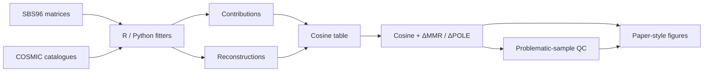

# Robustness of Mutational Signature Fitting in Colorectal Cancer: Effects of Algorithm, Reference Catalogue, Sequencing Scope, and Sample Quality Control

**Master’s Research Project Report**  
MSc Bioinformatics and Computational Biology  
University of Bern

**Author:** [Student Name]  
**Email:** [student@unibe.ch]  
**Matriculation number:** [XXXXXX]

**Affiliation:**  
Interfaculty Bioinformatics Unit / [Host laboratory], University of Bern

**Supervision:**  
[Supervisor Name]  
[Co-supervisor / Adviser Name]

**Date:** November 2025

---

## Acknowledgments

[Personalize this section.]

I would like to thank my supervisor and laboratory colleagues for guidance throughout this research project, for access to the Battuello *et al.* cohorts and accompanying resources, and for constructive feedback on the analytical design. I am also grateful to the developers of the open-source signature-fitting packages used in this work, and to the contributors of COSMIC and TCGA for making reference catalogues and clinical data publicly available.

Finally, I thank my family and friends for their support during the MSc programme.

[Student Name]  
Bern, November 2025

---

## Abstract

Mutational signature analysis is widely used to interpret somatic mutation patterns in cancer, including mismatch-repair (MMR) deficiency and POLE ultramutation in colorectal cancer (CRC). In practice, quantitative signature contributions depend on arbitrary workflow choices: the fitting algorithm, the COSMIC reference catalogue, and the next-generation sequencing (NGS) assay. Battuello *et al.* (2024) quantified these effects in preclinical and clinical CRC using dual mathematical and biological criteria. The present research project independently reimplements that framework, expands it across additional tools and COSMIC releases, and tests whether discarding problematic samples—following caveats from Maura *et al.* (2019)—improves biological and clinical associations.

Four SBS96 mutation matrices were analysed: preclinical CRC cell lines profiled by WES and TSO-500 (*n* = 230), the same lines by WGS (*n* = 63), and TCGA clinical CRC WES (*n* = 152). Catalogue fitting was performed with ten tools against COSMIC v2, v3.2, v3.4, v3.5, v3.6, and a CRC tissue-specific (TS) subset. Reconstruction quality was measured by cosine similarity (assigned if ≥ 0.9). Biological utility was measured by ΔMMR (median MSI − MSS MMR contribution) and ΔPOLE (median POLE-MUT − POLE-WT among MSS). Mutation downsampling estimated catalogue-specific mutation thresholds. Problematic samples were flagged for low cosine, low mutation count, or high flat-signature load, and Δ scores plus TCGA overall survival were recomputed after filtering.

Key Battuello benchmarks reproduced within tight tolerance: MutationalPatterns ΔMMR of 0.344 / 0.257 / 0.272 for v2 / v3.2 / TS; SigProfilerAssignment (SPA) assignment rate 79.1% on preclinical WES · v2; and NGS ΔMMR ordering TSO-500 > WES > WGS (0.323 > 0.257 > 0.115) with elevated flat signatures on WGS MSI. Among the paper’s original tools, SPA maximised ΔMMR (0.675); with expanded tools, sigLASSO reached 0.734. Richer catalogues lowered the mutation count needed for cosine ≥ 0.9 but attenuated ΔMMR. Discarding problematic samples did not systematically strengthen ΔMMR or survival associations.

These results confirm that algorithm and reference choice are first-order drivers of CRC signature readouts, that high reconstruction cosine on WGS does not imply stronger MMR/POLE contrast, and that quality-control discard is useful for reporting but is not a free robustness remedy.

**Keywords:** Mutational signatures; colorectal cancer; COSMIC; catalogue fitting; MMR; POLE; NGS; quality control.

---

## Table of Contents

1. [Introduction](#1-introduction)  
 1.1 [Mutational signatures in cancer genomics](#11-mutational-signatures-in-cancer-genomics)  
 1.2 [Clinical relevance in colorectal cancer](#12-clinical-relevance-in-colorectal-cancer)  
 1.3 [Sources of variability in signature fitting](#13-sources-of-variability-in-signature-fitting)  
 1.4 [Quality control and problematic samples](#14-quality-control-and-problematic-samples)  
 1.5 [Objectives](#15-objectives)  
2. [Materials and Methods](#2-materials-and-methods)  
 2.1 [Datasets](#21-datasets)  
 2.2 [Reference catalogues](#22-reference-catalogues)  
 2.3 [Fitting algorithms](#23-fitting-algorithms)  
 2.4 [Evaluation criteria](#24-evaluation-criteria)  
 2.5 [Mutation-count downsampling](#25-mutation-count-downsampling)  
 2.6 [Problematic-sample discard and survival](#26-problematic-sample-discard-and-survival)  
 2.7 [Analyses not reproduced](#27-analyses-not-reproduced)  
 2.8 [Computational pipeline](#28-computational-pipeline)  
3. [Results and Discussion](#3-results-and-discussion)  
 3.1 [Study design overview](#31-study-design-overview)  
 3.2 [Effect of the fitting algorithm](#32-effect-of-the-fitting-algorithm)  
 3.3 [Effect of the reference catalogue](#33-effect-of-the-reference-catalogue)  
 3.4 [Effect of NGS scope](#34-effect-of-ngs-scope)  
 3.5 [Minimum mutation count across catalogues](#35-minimum-mutation-count-across-catalogues)  
 3.6 [Discarding problematic samples](#36-discarding-problematic-samples)  
 3.7 [Replication audit and limitations](#37-replication-audit-and-limitations)  
 3.8 [Practical implications](#38-practical-implications)  
4. [Conclusions](#4-conclusions)  
[Bibliography](#bibliography)  
[Appendix A — Supplementary figures](#appendix-a--supplementary-figures)  
[Appendix B — Supplementary tables](#appendix-b--supplementary-tables)

---

## List of Figures

| Figure | Caption |
|--------|---------|
| Figure 1 | Cosine similarity by fitting algorithm (preclinical WES, COSMIC v2) |
| Figure 2 | MMR contribution in MSI versus MSS by algorithm |
| Figure 3 | ΔMMR by algorithm |
| Figure 4 | POLE contribution by algorithm |
| Figure 5 | ΔPOLE by algorithm |
| Figure 6 | MMR SBS composition in MSI by reference |
| Figure 7 | Cosine similarity across COSMIC v2, v3.2, and TS |
| Figure 8 | MMR contributions by reference (preclinical WES) |
| Figure 9 | Per-SBS MMR mix by reference |
| Figure 10 | Cosine similarity by NGS assay (MutationalPatterns · v3.2) |
| Figure 11 | MMR contributions by NGS assay |
| Figure 12 | POLE contributions by NGS assay |
| Figure 13 | Signature-class composition in MSI by NGS assay |
| Figure 14 | Preclinical cosine versus mutation count by COSMIC version |
| Figure 15 | Clinical cosine versus mutation count by COSMIC version |
| Figure 16 | Preclinical mutation threshold by COSMIC version |
| Figure 17 | Clinical mutation threshold by COSMIC version |
| Figure 18 | Preclinical assigned fraction versus mutations |
| Figure 19 | Clinical assigned fraction versus mutations |

*File names in `figures/` are listed in [`FIGURES.md`](FIGURES.md).*

---

## List of Tables

| Table | Caption |
|-------|---------|
| Table 1 | Cohorts and SBS96 matrices |
| Table 2 | Algorithm comparison on preclinical WES · COSMIC v2 |
| Table 3 | MutationalPatterns ΔMMR by reference versus Battuello *et al.* |
| Table 4 | NGS-scope ΔMMR and flat load (MutationalPatterns · v3.2) |
| Table 5 | Inferred mutation thresholds for cosine ≥ 0.9 |
| Table 6 | Paper-versus-replicate audit |
| Table 7 | Limitations and mitigations |

---

# 1. Introduction

## 1.1 Mutational signatures in cancer genomics

Cancer genomes accumulate somatic mutations under the influence of exogenous exposures, endogenous DNA-damage processes, and defects in DNA repair. Alexandrov and colleagues showed that these processes leave characteristic patterns of single-base substitutions (SBS) that can be summarised as **mutational signatures**—typically vectors over the 96 pyrimidine-centred trinucleotide contexts (Alexandrov *et al.*, 2020). Once a reference catalogue of signatures is available, observed tumour spectra can be decomposed by **catalogue fitting**, yielding per-sample contribution estimates that are used for biological interpretation, biomarker development, and clinical stratification.

The COSMIC catalogue of mutational signatures has become the *de facto* reference for SBS analysis (Tate *et al.*; Alexandrov *et al.*, 2020). Successive releases (v2, v3.x) have expanded both the number of signatures and the granularity of flat or clock-like components, changing the fitting problem that downstream tools solve. Fitting itself is implemented in many packages—including MutationalPatterns (Blokzijl *et al.*, 2018), deconstructSigs (Rosenthal *et al.*, 2016), SigProfilerAssignment, MuSiCal, sigLASSO, sigfit, and others—each with distinct regularisation, optimisation, and post-processing choices.

## 1.2 Clinical relevance in colorectal cancer

Colorectal cancer (CRC) is a particularly informative setting for signature analysis because two molecular subtypes leave strong, clinically actionable mutational footprints. Tumours with microsatellite instability (MSI) caused by defective MMR are enriched for signatures such as SBS6, SBS15, SBS20, SBS21, SBS26, and SBS44. Ultramutated tumours harbouring exonuclease-domain mutations in *POLE* are dominated by SBS10a/b (and related components). Signature contributions are therefore used not only for exploratory analysis but as quantitative correlates of MSI and POLE status.

If signature-based readouts are to support research or clinical decisions, they must be stable under reasonable workflow variation. Battuello *et al.* (2024) demonstrated that this is not automatically the case: reconstruction fidelity and subtype separation can move in opposite directions depending on the algorithm, the COSMIC version, and the sequencing assay.

## 1.3 Sources of variability in signature fitting

Three workflow axes are especially consequential.

**Fitting algorithm.** Different solvers impose different sparsity and non-negativity constraints. Tools that aggressively prune weak contributions may improve subtype contrast while leaving more samples with poor reconstructions (lower cosine similarity). Conversely, permissive tools may achieve high cosine at the cost of diluted biological signal.

**Reference catalogue.** Larger catalogues improve the mathematical fit of observed spectra but can redistribute weight from subtype-informative signatures into flat or related components, attenuating ΔMMR even when cosine rises.

**NGS scope.** Whole-genome sequencing captures mutations genome-wide, including intergenic and intronic contexts where flat signatures may dominate. Targeted and exome assays enrich coding regions and can paradoxically yield stronger MMR/POLE contrast for CRC subtype stratification (Battuello *et al.*, 2024).

## 1.4 Quality control and problematic samples

Beyond algorithm and catalogue choice, sample-level quality strongly affects signature attribution. Maura *et al.* (2019), writing primarily for haematological malignancies, emphasised practical pitfalls including sparse mutation counts, overfitting to large catalogues, and ambiguity introduced by flat signatures (e.g. SBS3, SBS5, SBS8, SBS40). These caveats motivate an additional question that Battuello *et al.* did not systematically answer for CRC: if samples that fail reconstruction, fall below a mutation threshold, or carry high flat load are discarded, do biological associations improve across tools and catalogues?

## 1.5 Objectives

This research project had three objectives:

1. **Replication.** Independently reimplement the Battuello *et al.* evaluation framework on publicly available CRC SBS96 matrices and recover key numerical benchmarks (ΔMMR by algorithm and reference; SPA assignment rate; NGS ΔMMR ordering; flat-signature inflation on WGS).
2. **Expansion.** Extend the analysis to additional fitting tools, newer COSMIC releases (v3.4–v3.6), a CRC tissue-specific catalogue, and a multi-catalogue mutation-burden threshold analysis.
3. **Quality-control discard.** Define problematic samples using cosine, mutation count, and flat contribution; recompute ΔMMR / ΔPOLE and exploratory overall survival associations with versus without those samples; and assess whether filtering systematically strengthens clinical-facing readouts.

---

# 2. Materials and Methods

## 2.1 Datasets

Four SBS96 count matrices (GRCh38 contexts) matching Battuello *et al.* were analysed (Table 1).

**Table 1. Cohorts and SBS96 matrices.**

| Cohort | Assay | Samples | Role |
|--------|-------|---------|------|
| Preclinical CRC cell lines | WES | 230 | Primary algorithm / reference grid |
| Preclinical CRC cell lines | TSO-500 | 230 | NGS-scope comparison |
| Preclinical CRC cell lines | WGS | 63 | NGS-scope comparison |
| TCGA clinical CRC | WES | 152 | Clinical contrast; mutation threshold; survival |

MSI / MSS and POLE-MUT / POLE-WT labels were taken from project metadata derived from the paper’s supplementary tables. Signature group definitions (MMR, POLE, flat, artefact) were version-specific (v2 `Signature_*` names; v3.x SBS names; SBS40a/b/c summed where relevant).

## 2.2 Reference catalogues

Catalogue fitting used COSMIC SBS references on GRCh38:

- COSMIC **v2**, **v3.2**, **v3.4**, **v3.5**, **v3.6**
- **TS** — CRC tissue-specific subset of COSMIC v3.2 (24 SBS), matching the GitHub `CRC_Specific` list accompanying Battuello *et al.* (the paper text cites *n* = 26; the published list of 24 was used and the difference disclosed)

## 2.3 Fitting algorithms

**Paper core (five tools):** MutationalPatterns, deconstructSigs, signature.tools.lib, SigProfilerAssignment (SPA), MuSiCal.

**Expansion (five tools):** sigLASSO, sigfit, sigminer, SigsPack, YAPSA.

SignatureAnalyzer was disabled because the available implementation performs *de novo* NMF with post-hoc mapping rather than equivalent catalogue fitting under the shared cosine / contribution schema used here.

R and Python fitters wrote contributions (`signatures × samples`) and reconstructions (`contexts × samples`). Cosine similarity between observed and reconstructed SBS96 profiles was stored in a master long table. Samples with cosine ≥ **0.9** were labelled assigned. Occasional missing cosines (e.g. some sigLASSO × v2 fits) were dropped from distribution plots and flagged in quality control. On overcomplete catalogues (e.g. v3.6), SigsPack fell back from quadratic programming to non-negative least squares when required.

## 2.4 Evaluation criteria

Following Battuello *et al.*, two complementary criteria were used:

1. **Mathematical.** Cosine similarity; assignment rate = fraction of samples with cosine ≥ 0.9.
2. **Biological.** For each Tool × COSMIC × Dataset, sum contributions within the MMR (or POLE) group; compute  
   ΔMMR = median(MMR | MSI) − median(MMR | MSS) and  
   ΔPOLE = median(POLE | POLE-MUT) − median(POLE | POLE-WT among MSS).  
   Group differences were tested with two-sided Wilcoxon rank-sum tests.

Figures follow the visual grammar of the original paper (`theme_bw`; MSI/MSS colours; POLE colours; dashed line at cosine = 0.9).

## 2.5 Mutation-count downsampling

To estimate the minimum mutation count supporting cosine ≥ 0.9, SBS96 profiles were multinomial-subsampled at fractions 5–95% (five replicates), refitted with MutationalPatterns for every configured COSMIC key, and summarised as cosine-versus-mutation curves and inferred thresholds. This addresses the same scientific question as the paper’s variant-list shuffling experiment; absolute thresholds are approximate and method-dependent.

## 2.6 Problematic-sample discard and survival

Informed by Maura *et al.* (2019), samples were flagged as problematic if **any** of the following held for a given Tool × COSMIC × Dataset:

1. cosine similarity < 0.9;
2. mutation count below the Dataset × COSMIC threshold inferred in §2.5 (fallback 323 / 64 for preclinical / clinical if unavailable);
3. flat-signature contribution ≥ 0.25.

ΔMMR and ΔPOLE were recomputed after discarding flagged samples under four filters (drop low cosine; drop low mutations; drop high flat; drop any). Overall survival (OS) for clinical WES was obtained from the GDC API for TCGA-COAD/READ (*n* = 152; 36 death events). Association of MMR contribution with OS was assessed by median-split Cox models and log-rank tests before versus after filtering for selected settings.

## 2.7 Analyses not reproduced

The following original-paper panels were omitted for lack of input data:

- Metanormal rematching (paper Fig. 6C–D).
- Exon / intron / extragenic regional SBS96 pies (paper Fig. 3D, right). Signature-class stacked bars by NGS type were used as a related proxy.

## 2.8 Computational pipeline

Analyses were implemented under a unified dual-language pipeline (R and Python fitters → shared cosine schema → R downstream). The master cosine table contains **34,132** rows. Configuration, scripts, tables, and figure packs live under `mywork/` in the project repository; figure captions are mapped in [`FIGURES.md`](FIGURES.md).

---

# 3. Results and Discussion

## 3.1 Study design overview

Analyses were organised along the three axes of Battuello *et al.*—algorithm, reference catalogue, and NGS scope—plus multi-COSMIC mutation-burden and problematic-sample discard expansions. Results are discussed immediately after each subsection, following the combined Results-and-Discussion organisation common in MSc research reports.

## 3.2 Effect of the fitting algorithm

On preclinical WES with COSMIC **v2**, tools differed in both cosine distributions and biological separation (Figures 1–5; Table 2).

*Figure 1. Cosine similarity by fitting algorithm on preclinical WES · COSMIC v2. Dashed line = 0.9. (File: `Fig01_alg_cosine_by_tool_v2`.)*

Most tools reached median cosine ≥ 0.9. SPA left a substantial fraction unassigned (**182/230 = 79.1%** assigned), matching the ≈ 79% figure reported by Battuello *et al.*

*Figure 2. MMR-signature contribution in MSI versus MSS by algorithm.*

*Figure 3. ΔMMR by algorithm on preclinical WES · COSMIC v2.*

**Table 2. Algorithm comparison on preclinical WES · COSMIC v2.**

| Tool | ΔMMR | ΔPOLE | Notes |
|------|------|-------|-------|
| MutationalPatterns | 0.344 | 0.593 | Paper ≈ 0.34 / 0.59 |
| deconstructSigs | 0.279 | 0.578 | Paper core |
| signature.tools.lib | 0.324 | 0.679 | Paper core |
| SigProfilerAssignment | **0.675** | **0.704** | Highest ΔMMR among paper tools |
| MuSiCal | 0.220 | 0.591 | Paper core |
| sigLASSO | **0.734** | 1.000 | Expansion; exceeds SPA |
| sigfit | 0.291 | 0.584 | Expansion |
| sigminer | 0.344 | 0.593 | Expansion (aligned with MutationalPatterns) |
| SigsPack | 0.333 | 0.575 | Expansion |
| YAPSA | 0.344 | 0.593 | Expansion (aligned with MutationalPatterns) |

All tools separated MSI from MSS (Wilcoxon *P* ≪ 0.05), but ΔMMR magnitude varied strongly. Among the paper’s five-tool set, SPA had the highest ΔMMR (0.675) at the cost of lower assignment rate—consistent with the published ranking. With the expanded tool set, **sigLASSO ΔMMR (0.734)** exceeded SPA. This does not contradict the original ranking; it shows that rankings are conditional on the tool universe under comparison.

*Figure 4. POLE-signature contribution by algorithm.*

*Figure 5. ΔPOLE by algorithm.*

**Discussion.** Algorithm choice is a first-order driver of both assignment rate and subtype Δ scores. SPA maximises biological contrast among classical tools while rejecting more samples at the cosine threshold. Expansion tools can reorder the ranking, so statements about the “best” method must specify the comparator set.

## 3.3 Effect of the reference catalogue

MutationalPatterns on preclinical WES across **v2 / v3.2 / TS** reproduced the paper’s ΔMMR pattern (Table 3; Figures 6–9).

**Table 3. MutationalPatterns ΔMMR by reference versus Battuello *et al.***

| Reference | Paper ΔMMR | This study | Absolute difference | Match |
|-----------|------------|------------|---------------------|-------|
| COSMIC v2 | ≈ 0.34 | **0.344** | 0.004 | yes |
| COSMIC v3.2 | ≈ 0.26 | **0.257** | 0.003 | yes |
| Tissue-specific (TS) | ≈ 0.27 | **0.272** | 0.002 | yes |

*Figure 6. MMR SBS composition in MSI by reference.*

*Figure 7. Cosine similarity for MutationalPatterns across v2, v3.2, and TS.*

*Figure 8. MMR contributions by reference on preclinical WES.*

*Figure 9. Per-SBS MMR mix shifts with reference (e.g. SBS6 high on v2; redistributed on v3.2 / TS).*

Larger catalogues raised cosine but **shrunk ΔMMR**. Extending to COSMIC v3.4–v3.6, trends continued toward higher cosine and attenuated ΔMMR for several tools. For MutationalPatterns on preclinical WES, ΔMMR fell from 0.344 (v2) to 0.257 (v3.2) and further to ≈ 0.246 on v3.5 / v3.6.

**Discussion.** Catalogue growth improves mathematical reconstruction while diluting subtype-informative weight—exactly the mathematical-versus-biological tension emphasised by Battuello *et al.* Tissue-specific catalogues partially recover ΔMMR relative to the full v3.2 set, supporting the value of tissue-informed references when the biological target is known.

## 3.4 Effect of NGS scope

MutationalPatterns · COSMIC v3.2 on preclinical WES / WGS / TSO-500 reproduced the paper’s NGS ordering (Table 4; Figures 10–13).

**Table 4. NGS-scope ΔMMR and flat load (MutationalPatterns · v3.2).**

| Data type | ΔMMR | Flat in MSI (median) | Pattern versus paper |
|-----------|------|----------------------|----------------------|
| TSO-500 | **0.323** | ≈ 0 | Highest ΔMMR (paper ≈ 0.32) |
| WES | **0.257** | ≈ 0 | Intermediate (paper ≈ 0.26) |
| WGS | **0.115** | **0.269** | Lowest ΔMMR; flat elevated (paper ≈ 0.11) |

*Figure 10. Cosine by NGS assay · MutationalPatterns · v3.2. Dashed line = 0.9.*

*Figure 11. MMR contributions by NGS assay.*

*Figure 12. POLE contributions by NGS assay.*

*Figure 13. Signature-class composition in MSI by NGS type (regional exon/intron/extragenic pies not available).*

Ordering **TSO > WES > WGS** for ΔMMR matches the paper. High technical cosine on WGS coexists with weaker biological MMR separation, explained by elevated flat signatures in MSI on WGS (median 0.269 versus ≈ 0 on WES / TSO).

**Discussion.** Genome-wide data are not automatically better for MMR/POLE stratification. WGS is not “technically worse”—reconstruction cosine is high—but subtype contrast is reduced when flat components absorb a larger share of the MSI profile. Coding-enriched assays remain effective for this biological endpoint.

## 3.5 Minimum mutation count across catalogues

Subsampling 5–95% of mutations (five replicates) and refitting MutationalPatterns for every configured COSMIC version yielded cosine-versus-mutation curves and inferred thresholds for cosine ≥ 0.9 (Table 5; Figures 14–19).

**Table 5. Inferred mutation thresholds for cosine ≥ 0.9.**

| Dataset | COSMIC | Inferred threshold | Paper (v2 context) |
|---------|--------|--------------------|--------------------|
| Preclinical | v2 | **≈ 351** | 323 |
| Preclinical | TS | ≈ 284 | — |
| Preclinical | v3.2–v3.6 | ≈ 146 | — |
| Clinical | v2 | **≈ 49** | 64 |
| Clinical | v3.2–v3.6 | ≈ 17–21 | — |
| Clinical | TS | ≈ 29 | — |

*Figure 14. Preclinical cosine versus mutation count by COSMIC version.*

*Figure 15. Clinical cosine versus mutation count by COSMIC version.*

*Figure 16. Inferred preclinical mutation threshold by COSMIC (dashed line = paper v2 value 323).*

*Figure 17. Inferred clinical mutation threshold by COSMIC (dashed line = paper v2 value 64).*

*Figure 18. Preclinical assigned fraction (cosine ≥ 0.9) versus mutations.*

*Figure 19. Clinical assigned fraction versus mutations.*

**Discussion.** The mutation count needed for cosine ≥ 0.9 depends on both cohort mutation quality/quantity and reference size. Richer catalogues reach the threshold at lower counts. Clinical WES needs far fewer mutations than the unmatched preclinical cell-line cohort—the same directional contrast as the paper. Absolute thresholds differ slightly from Battuello *et al.* because downsampling was implemented as multinomial SBS96 subsampling rather than variant-list shuffling; the scientific conclusion is unchanged. Paper metanormal panels (323 → 145 after PBMC-matched calling) were not reproduced for lack of local metanormal data.

## 3.6 Discarding problematic samples

Samples flagged under the rules in §2.6 were removed and ΔMMR / ΔPOLE recomputed across the Tool × COSMIC × Dataset grid (preclinical and clinical WES).

Approximately **10%** of sample × tool × COSMIC rows were flagged by at least one rule. Effects on biological separation were highly setting-dependent:

- For **MutationalPatterns**, few samples failed QC on v2–v3.6, so ΔMMR was essentially unchanged after filtering.
- For **SPA on COSMIC v3.2–v3.6**, flat-load flags removed ≈ 87% of preclinical samples; ΔMMR rose modestly (e.g. v3.2: 0.241 → 0.302) only at heavy sample loss.
- Across all Tool × COSMIC × Dataset blocks, ΔMMR increased in only **18 of 102** (≈ 18%); the median change on the preclinical cohort was **0**.

Exploratory survival analysis on TCGA OS (*n* = 152; 36 events) used a median split of MMR contribution. For MutationalPatterns · v3.2, no clinical samples were discarded and associations were non-significant (hazard ratio ≈ 0.88, Cox *P* ≈ 0.70). For SPA · v2 after filtering, associations remained non-significant (hazard ratio ≈ 1.33, Cox *P* ≈ 0.47). With only 36 events, these tests are underpowered.

**Discussion.** Maura-style QC successfully identifies unstable fits, but blanket discarding does not systematically strengthen MSI/POLE separation or OS association in this CRC setting. Apparent gains are tool- and catalogue-specific and can cost most of the cohort. Filtering is therefore best treated as diagnostic reporting rather than a default robustness fix. The flat cut-off of 0.25 is one operational choice; SPA on large catalogues is particularly sensitive to it.

## 3.7 Replication audit and limitations

**Table 6. Paper-versus-replicate audit.**

| Metric | Setting | Paper | This study | Match |
|--------|---------|-------|------------|-------|
| ΔMMR | MutationalPatterns · preclinical WES · v2 | ≈ 0.34 | **0.344** | yes |
| ΔMMR | MutationalPatterns · preclinical WES · v3.2 | ≈ 0.26 | **0.257** | yes |
| ΔMMR | MutationalPatterns · preclinical WES · TS | ≈ 0.27 | **0.272** | yes |
| Fraction assigned (≥ 0.9) | SPA · preclinical WES · v2 | ≈ 79% | **79.1%** | yes |
| ΔMMR ranking | SPA among paper tools · v2 | highest | **0.675** | yes |
| ΔMMR by NGS | MutationalPatterns · v3.2 | TSO > WES > WGS | **0.323 > 0.257 > 0.115** | yes |
| Flat in MSI | MutationalPatterns · v3.2 · WGS | elevated | **median 0.269** | yes |
| Mutation threshold order | preclinical ≫ clinical (v2) | 323 / 64 | ≈ 351 / ≈ 49 | same contrast |

**Table 7. Limitations and mitigations.**

| Limitation | Impact | Mitigation |
|------------|--------|------------|
| No metanormal (paper Fig. 6C–D) | Cannot claim artefact-driven 323 → 145 rematch | Multi-COSMIC Fig. 16–17 reported instead |
| No exon/intron/extragenic SBS96 | Cannot redraw paper Fig. 3D regional pies | Class bars + flat inflation on WGS as proxy |
| TS = 24 SBS vs paper text “26” | Minor catalogue difference | Disclosed; ΔMMR still matches ≈ 0.27 |
| SignatureAnalyzer off | Absent from algorithm ranking | Not catalogue-fitting equivalent |
| Occasional missing cosines | Dropped from boxplots | Reported in Methods / QC |
| SigsPack × v3.6 NNLS fallback | Solver, not biology | Methods note |
| Downsampling method | Multinomial SBS96 vs paper `shuf` | Same question; thresholds approximate |
| Flat cut-off = 0.25 | Aggressive for SPA on large catalogues | Discard rates disclosed |
| Survival power | Only 36 OS events | Exploratory Cox / log-rank only |

This study does not claim exact reproduction of paper Fig. 6C–D or regional WGS pies; does not call SPA universally “best”; does not imply that WGS is technically inferior; and does not claim that discarding problematic samples broadly improves clinical associations.

## 3.8 Practical implications

For CRC MMR/POLE signature stratification, results should be reported jointly with **tool**, **COSMIC version**, and **assay**. High cosine similarity is necessary for trustworthy reconstruction but is not sufficient evidence of clinical subtype utility. Coding-enriched assays and carefully chosen (possibly tissue-informed) catalogues may preserve biological contrast better than maximising genome coverage or catalogue size alone. Quality-control flags for low cosine, sparse mutations, and high flat load should be reported alongside Δ scores; automatic exclusion of flagged samples should be justified by retained sample size and pre-specified sensitivity analyses.

---

# 4. Conclusions

This research project independently replicated Battuello *et al.* on CRC mutational-signature fitting and extended the analysis across additional tools, COSMIC releases, and a Maura-style problematic-sample discard experiment.

The principal conclusions are:

1. **Replication succeeded within tight tolerance.** MutationalPatterns ΔMMR for v2 / v3.2 / TS, SPA assignment rate, NGS ΔMMR ordering with WGS flat-signature inflation, and the preclinical-versus-clinical mutation-burden contrast all matched the original study’s direction and approximate magnitude.
2. **Algorithm and reference choice dominate variability.** Among classical tools, SPA maximises biological contrast at the cost of more unassigned samples. Larger COSMIC catalogues raise cosine while attenuating ΔMMR. Expanded tools can reorder rankings (sigLASSO > SPA on ΔMMR).
3. **NGS breadth is not a substitute for biological scope.** TSO-500 and WES outperform WGS for MMR subtype contrast under MutationalPatterns · v3.2 despite high WGS reconstruction fidelity.
4. **Mutation thresholds are catalogue-dependent.** The mutation count needed for cosine ≥ 0.9 falls as catalogues grow.
5. **Discarding problematic samples is not a free robustness win.** QC flags are informative, but blanket filtering does not systematically strengthen ΔMMR or survival associations and can discard most of a cohort for some tool × catalogue combinations.

Taken together, the work reinforces a practical message for CRC signature analysis: report tool, catalogue, and assay with every Δ score; treat cosine as necessary but not sufficient; and use sample-level QC to annotate—not automatically rewrite—biological conclusions.

---

# Bibliography

1. Battuello, P., *et al.* (2024). Impact of the algorithmic choice and the reference catalogue on mutational signature analysis in colorectal cancer. *Briefings in Bioinformatics*, 25(4), bbae249. https://doi.org/10.1093/bib/bbae249

2. Maura, F., *et al.* (2019). A practical guide for mutational signature analysis in hematological malignancies. *Nature Communications*, 10, 4901. https://doi.org/10.1038/s41467-019-12691-y

3. Alexandrov, L. B., *et al.* (2020). The repertoire of mutational signatures in human cancer. *Nature*, 578, 94–101.

4. Tate, J. G., *et al.* COSMIC: the Catalogue Of Somatic Mutations In Cancer. *Nucleic Acids Research*.

5. Blokzijl, F., Janssen, R., van Boxtel, R., & Cuppen, E. (2018). MutationalPatterns: comprehensive genome-wide analysis of mutational processes. *Genome Medicine*.

6. Rosenthal, R., McGranahan, N., Herrero, J., Taylor, B. S., & Swanton, C. (2016). deconstructSigs: delineating mutational processes in single tumors distinguishes DNA repair deficiencies and patterns of carcinoma evolution. *Genome Biology*.

7. Islam, S. M. A., *et al.* Uncovering novel mutational signatures by *de novo* extraction with SigProfilerExtractor. *Cell Genomics*. (SigProfiler / SPA ecosystem)

8. Jin, H., *et al.* MuSiCal improves mutation signature analysis. (MuSiCal)

9. Li, S., *et al.* sigLASSO: sparse modelling of mutational signatures. (sigLASSO)

10. Gori, K., & Baez-Ortega, A. sigfit: flexible Bayesian inference of mutational signatures. (sigfit)

11. Wang, S., *et al.* sigminer: an R package for mutational signature analysis. (sigminer)

*Package versions are those installed in the project environment at analysis time.*

---

# Appendix A — Supplementary figures

Full Algorithm × COSMIC and NGS grids are provided as **FigS1–FigS5** in [`figures/`](figures/):

| File | Role |
|------|------|
| `FigS1_cosine_by_tool_cosmic` | All tools × COSMIC cosine |
| `FigS2_delta_MMR_by_tool_cosmic` | ΔMMR overview |
| `FigS3_ngs_cosine_by_datatype` | Full NGS cosine grid |
| `FigS4_ngs_delta_MMR` | Full NGS ΔMMR grid |
| `FigS5_ngs_delta_POLE` | Full NGS ΔPOLE grid |

Additional discard-experiment plots live under `../../results/downstream/problematic_discard/plots/`.

---

# Appendix B — Supplementary tables

| Table / file | Content |
|--------------|---------|
| [`paper_vs_replicate.tsv`](paper_vs_replicate.tsv) | Numeric replication audit |
| `../../results/downstream/tables/delta_MMR_POLE.tsv` | Full ΔMMR / ΔPOLE grid |
| `../../results/downstream/tables/assigned_fraction.tsv` | Assignment rates |
| `../../results/downstream/mutation_threshold/tables/mutation_count_threshold.tsv` | Fig. 6 thresholds |
| `../../results/downstream/problematic_discard/tables/filter_effect_summary.tsv` | Discard effect on Δ scores |
| `../../results/downstream/problematic_discard/tables/survival_MMR_high_vs_low.tsv` | Exploratory OS analysis |
| `../../metadata/clinical_survival.tsv` | TCGA OS (*n* = 152; 36 events) |

---

## Data and code availability

Pipeline configuration, scripts, cosine tables, downstream metrics, and the figure pack are available under `mywork/` in this repository:

| Need | Path |
|------|------|
| Pipeline README | [`../../README.md`](../../README.md) |
| Figures | [`figures/`](figures/) |
| Figure map | [`FIGURES.md`](FIGURES.md) |
| Concise manuscript draft | [`MANUSCRIPT.md`](MANUSCRIPT.md) *(separate working draft; not this report)* |
| Gap notes | [`THESIS_RESULTS_AND_GAPS.md`](THESIS_RESULTS_AND_GAPS.md) |
